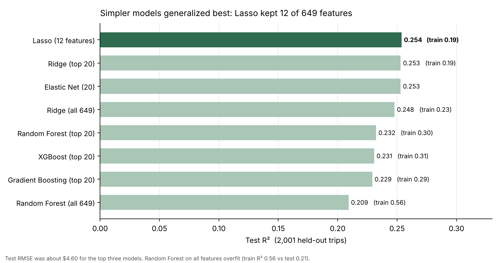
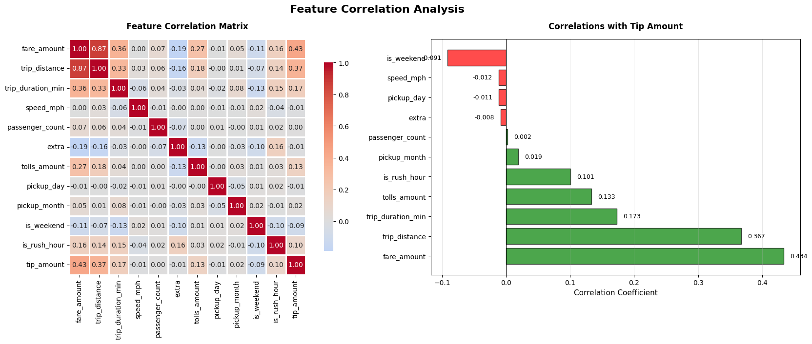
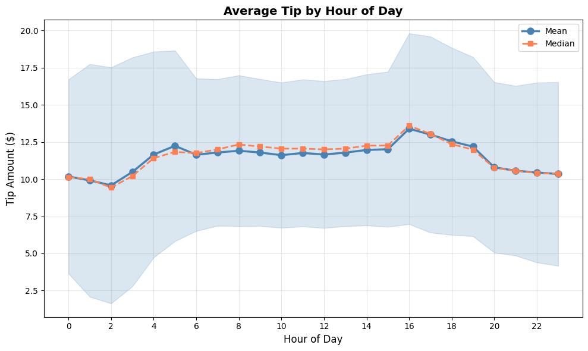
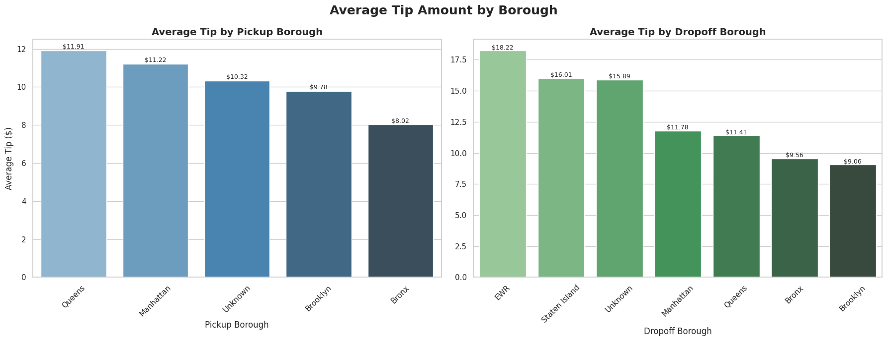
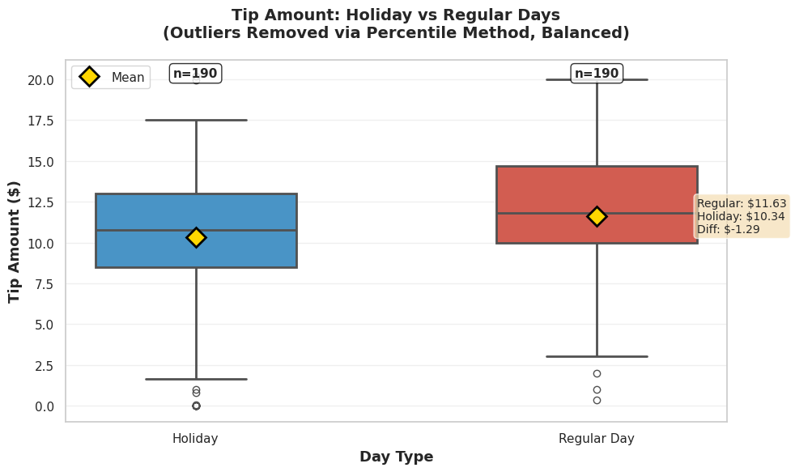

# NYC Yellow Taxi Tip Prediction

**What actually makes New Yorkers tip?** This project combines a full year of NYC Taxi & Limousine Commission trip records with weather and holiday data to find what drives tip amounts, then compares eight regression and machine learning models to predict them.

*Columbia University, IEOR 4523 Data Analytics (Fall 2025), Group 2, team of 5.*



## Key findings

- **Fare amount is by far the strongest driver of tips.** Lasso regression kept only 12 of 649 features, and fare amount had the largest coefficient by a wide margin.
- **Where the trip ends matters.** Trips ending in outer-borough "Boro Zones" tip less, while trips ending at Newark Airport tip the most.
- **Timing matters a little.** Rush-hour trips tip slightly more, while weekend and late-night trips tip slightly less. Average tips are fairly stable across the day.
- **Simpler models generalized best.** Lasso, Ridge and Elastic Net all reached a test R² of about 0.25 (RMSE about $4.60). Tree-based models overfit: Random Forest on all features scored 0.56 on training data but only 0.21 on test.
- **Tips are hard to predict.** Even the best model explains about a quarter of the variation, because much of tipping depends on the rider, which the data cannot see. The value is in identifying which factors matter, not in precise prediction.

## Data

| Source | Use |
|---|---|
| [NYC TLC Yellow Taxi trip records](https://www.nyc.gov/site/tlc/about/tlc-trip-record-data.page), January to December 2024 | 30.7 million trips |
| NYC TLC taxi zone lookup and shapefiles | Borough, zone and latitude/longitude (zone centroids) for pickups and drop-offs |
| [Open-Meteo](https://open-meteo.com/) historical weather API | Temperature, rain, snowfall and weather condition at pickup time and place |
| New York State Department of Civil Service | Federal and state holiday dates for 2024 (scraped) |

## Approach

1. **Combined** the 12 monthly TLC files into one dataset of **30,724,956 trips**.
2. **Cleaned and filtered** to trips where tips are reliably recorded and comparable: card payments only (cash tips are not recorded), positive fares, valid durations, trips under 150 miles, and trips with tolls and surcharges. This left **1.22 million trips**. Because of the toll filter, the analysis describes toll-paying trips, which include many airport and bridge rides, so average tips are higher than for all NYC taxi trips.
3. **Sampled 10,000 trips** at random, because the Open-Meteo API allowed 10,000 requests, then joined weather, holiday and location features.
4. **Engineered features** such as rush hour, weekend, time of day, trip duration and speed. One-hot encoding expanded the data to **649 features**.
5. **Explored** tipping patterns by hour, month, borough, weather and holidays, and checked multicollinearity with VIF.
6. **Modeled** with Ridge, Lasso, Elastic Net, Random Forest, XGBoost and Gradient Boosting on an 80/20 train/test split (8,003 / 2,001 trips), including versions limited to the top 20 features.

## Results









**Lasso's 12 selected features:** fare amount, drop-off service zone (Boro Zone), extra charges, weekend, drop-off longitude, snowfall, tolls, drop-off latitude, rush hour, pickup latitude, passenger count and night-time pickup.

## Repository structure

```
├── README.md
├── requirements.txt
├── NYC_yellow_taxi_data.ipynb     full analysis: cleaning, features, EDA, models
├── data/
│   ├── data_with_weather.csv      the 10,000-trip sample with weather features
│   ├── ny_holidays_2024.csv
│   └── Taxi Zone Shape Files/     NYC TLC taxi zone shapefile
└── images/
```

## How to run

1. Download the 2024 Yellow Taxi parquet files from the [TLC website](https://www.nyc.gov/site/tlc/about/tlc-trip-record-data.page). They total about 670 MB, so they are not included here.
2. Install dependencies:
   ```bash
   pip install -r requirements.txt
   ```
3. The notebook was run in Google Colab with data in Google Drive. Update the file paths near the top of the notebook to point to your local `data/` folder and the downloaded parquet files.
4. To skip the API step, start from `data/data_with_weather.csv`, which already contains the weather-enriched sample.

## Team

**Chitipat Montreeamornchet, Jack Chen, Priyanka Nair, Vieno Wu and Xiaoyi Liu.**

## Tech stack

Python, pandas, NumPy, GeoPandas, scikit-learn, XGBoost, statsmodels, Matplotlib, Seaborn, Folium, Open-Meteo API
